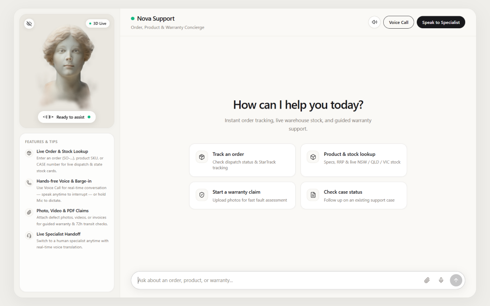
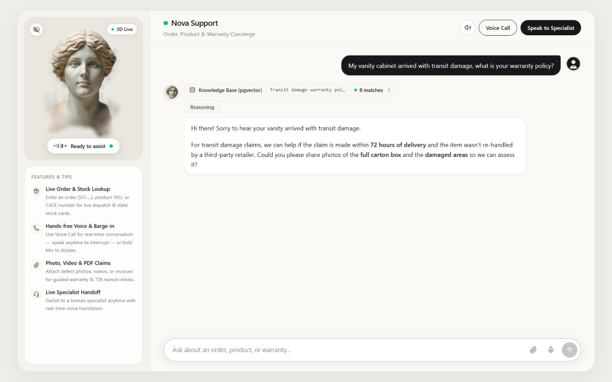
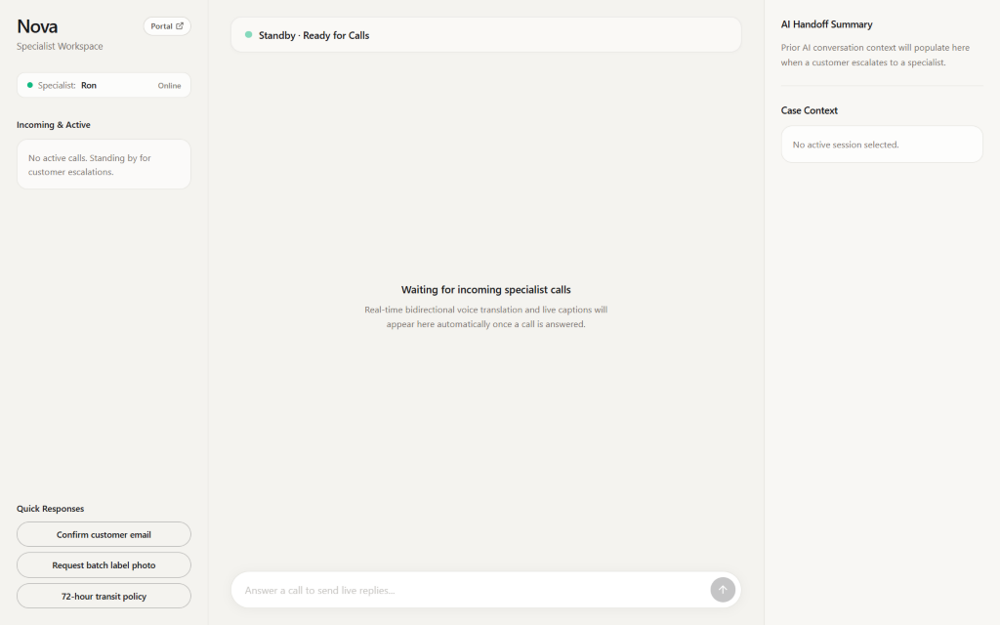
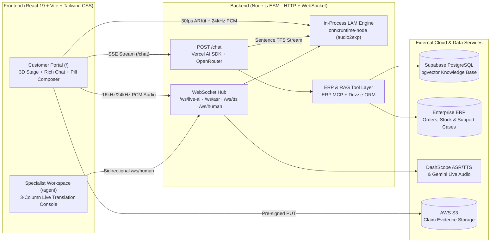

# Nova — AI 3D Digital Human Customer Service Platform

An end-to-end multimodal AI customer service and after-sales support platform featuring an **in-browser WebGL 3D Gaussian Splatting Digital Human (driven by in-process ONNX `audio2exp`)**, **streaming multi-step LLM reasoning**, **Supabase `pgvector` RAG knowledge base retrieval**, **live ERP order/inventory/case integration**, **hands-free real-time voice calls with barge-in**, and a **3-column live voice translation Specialist Workspace (`/agent`)**.

---

## Live UI Showcase

### 1. Customer Portal — 3D Avatar Stage, Quick Tips & Guided Entry (`/`)
The left sidebar pairs a live 30fps WebGL 3D Gaussian Splatting avatar stage (supporting scroll-to-zoom, one-click panel hide/show, and live audio waveform feedback) with a persistent **Features & Tips** guide. The right workspace provides a minimalist conversational interface with quick-start enquiry cards.



### 2. Conversational Stream — Bespoke Avatars, Database Tool Trace & Reasoning
Whenever Nova queries the **Supabase `pgvector` knowledge base** or **ERP system**, an expandable trace pill appears directly above the response (click to inspect query inputs and matched records). Validated orders, state warehouse stock, and support cases automatically render as clean structured UI cards.



### 3. 3-Column Specialist Workspace — Live Bidirectional Voice Translation (`/agent`)
Customers can escalate to a human specialist at any time via **Speak to Specialist**. The `/agent` workspace equips support specialists with incoming call management, one-click quick responses, real-time bidirectional voice translation (**English Customer ⇄ Mandarin Specialist**) with live captions, an **AI Handoff Summary**, and automatically extracted **Case Context** (Order IDs, SKUs, and Case references).



---

## Key Features

### 1. In-Process ONNX 3D Digital Human (`LAM 3D Gaussian Splatting`)
- **Zero-Python Local Inference**: The Node.js backend runs `onnxruntime-node` in-process against `lam_audio2exp.onnx`, decoding synthesized speech via bundled `ffmpeg` and generating **30fps, 52-channel ARKit blendshape weights** in real time.
- **Hardware-Clock Lip Sync & Barge-in**: Synchronized expression frames and 24kHz PCM audio stream over WebSocket (`/ws/lam-client/:sessionId`) to `gaussian-splat-renderer-for-lam` in the browser, consuming zero server GPU/CPU while idle and supporting instant interruption (barge-in).
- **Custom Avatar Assets**: Swap in any LAM-compatible `.zip` character package (see [LAM_CUSTOM_AVATAR_GUIDE.md](./LAM_CUSTOM_AVATAR_GUIDE.md)). The chat UI automatically captures a live portrait thumbnail from the WebGL stage on initial load.

### 2. Supabase `pgvector` Semantic Knowledge Base (`RAG`)
- Built on **PostgreSQL + `pgvector` + Drizzle ORM** to index warranty policies, defect eligibility rules, 72-hour transit damage requirements, and troubleshooting SOPs.
- Parallel multi-query semantic recall (`getInformation`) deduplicates results by cosine similarity and automatically links visual batch-number location guides for mirrors, shaving cabinets, vanity drawers, and outer cartons.

### 3. Live ERP Integration & Structured UI Cards
Powered by an in-process **ERP MCP tool layer** with role-separated read/write credentials. Tool outputs render natively as structured cards in the chat stream:

| Tool Name | Capability | Frontend Presentation |
| :--- | :--- | :--- |
| `getInformation` | Semantic vector search across warranty & troubleshooting SOPs in Supabase `pgvector` | Expandable database trace pill showing match count & recalled snippets |
| `check_order_status` | Live ERP lookup of sales orders, item fulfillments, carriers, and tracking numbers | Expandable trace pill + **Order & Dispatch Card** (with 1-click tracking copy) |
| `get_product_info` | Live ERP lookup of SKU specs, dimensions, RRP (AUD), and `NSW / QLD / VIC` stock levels | Expandable trace pill + **Product & State Warehouse Stock Card** |
| `start_warranty_claim` | Creates a formal `Support Case` in the ERP with strict **customer-typed email provenance validation** (preventing accidental extraction of store emails from uploaded invoices) | Expandable trace pill + **Support Case Confirmation Card** |
| `check_case_status` | Verifies existing ERP support case progress and outstanding items via Case Number + Email | Expandable trace pill + **Support Case Status Card** |

### 4. Full-Duplex Voice & Multimodal Evidence Pipeline
- **Hands-Free Live Voice Call (`Voice Call` / `/ws/live-ai`)**: End-to-end low-latency voice conversation powered by Gemini Live, inheriting prior chat context, executing ERP/RAG tools mid-call, supporting natural mid-sentence barge-in, and driving the 3D avatar.
- **Hold-to-Speak Dictation (`/ws/asr`)**: Real-time 16kHz PCM streaming speech-to-text powered by DashScope Qwen (`qwen-audio-3.1-asr-flash-streaming`) with a live floating caption popover.
- **Streaming Voice Playback & Graceful Fallback (`/ws/tts`)**: Sentence-chunked TTS synthesis drives the 3D avatar when connected, and automatically falls back to browser `MediaSource` streaming audio when 3D mode is paused.
- **Direct S3 Evidence Upload (`/upload-url`)**: Supports client-side resized photo previews (passed directly to multimodal vision), fault videos, and PDF purchase invoices uploaded via pre-signed S3 PUT URLs (with local mock fallback for development).

### 5. Cross-Language Human Specialist Handoff (`/agent`)
- **1-on-1 Live Voice Translation (`/ws/human`)**: Seamless escalation from AI chat to a live specialist with real-time bidirectional speech-to-speech translation and live bilingual captions.
- **Context Continuity**: Automatically transfers recent AI conversation turns into the specialist's **AI Handoff Summary** and highlights referenced `SO-…` orders, `SKU-…` products, and `CASE…` numbers under **Case Context**.

---

## System Architecture



---

## Project Structure

```text
AIChatBot-LAM-ONNX/
├── Frontend/                        # React 19 + Vite + Tailwind CSS SPA
│   ├── public/                      # Static assets, batch label guides (/guidance) & 3D avatar thumbnail
│   └── src/
│       ├── App.jsx                  # Customer Portal main view (/)
│       ├── pages/AgentConsole.jsx   # 3-Column Specialist Workspace (/agent)
│       ├── components/
│       │   ├── AvatarPanel.jsx      # 3D WebGL avatar stage & Features/Tips sidebar
│       │   ├── ToolResultCard.jsx   # Expandable DB/ERP trace pills & structured Order/Stock/Case cards
│       │   └── VoiceInputButton.jsx # Hold-to-speak streaming ASR button & live caption popover
│       └── hooks/                   # Hooks for LAM WebGL, Live Call, Human Handoff, ASR & TTS
├── Backend/                         # Node.js (ESM) server (local HTTP/WS & AWS SAM Lambda)
│   ├── assets/lam/                  # ONNX model (lam_audio2exp.onnx) & 3D character asset (.zip)
│   ├── setup/                       # Model downloader, pgvector DB seeder (seed.js) & RAG test scripts
│   └── src/
│       ├── index.js                 # Unified HTTP + multi-WebSocket server entrypoint
│       ├── ai/                      # OpenRouter streaming orchestration & warranty SOP system prompt
│       ├── avatar/                  # In-process ONNX inference, audio decoder & /ws/lam-client service
│       ├── audio/                   # DashScope ASR/TTS, Gemini Live voice call & human translation WS
│       ├── erp/                     # In-process ERP MCP client & order/product/warranty tools
│       └── rag/                     # Supabase PostgreSQL + pgvector schema, embeddings & recall
├── docs/images/                     # Live application UI screenshots
└── LAM_CUSTOM_AVATAR_GUIDE.md       # Guide for generating & exporting custom LAM 3D avatars
```

---

## Quick Start

### Prerequisites
- **Node.js** `>= 20.x`
- **PostgreSQL (Supabase)** with the `vector` (`pgvector`) extension enabled

### 1. Backend Setup

```bash
cd Backend
cp .env.example .env
npm install
```

Configure your credentials in `Backend/.env` (never commit `.env` or real API keys):
- `OPENROUTER_API_KEY` — LLM chat completion & text embedding provider
- `DATABASE_URL` — Supabase PostgreSQL connection string
- `DASHSCOPE_API_KEY` — Real-time streaming ASR & TTS synthesis
- `GEMINI_API_KEY` — Hands-free `Voice Call` & `/agent` live voice translation
- ERP integration credentials (see `Backend/.env.example`)

(Optional) Download the ONNX avatar model if not present and seed the RAG knowledge base:

```bash
npm run download:model
npm run db:seed
```

Start the backend server (listens on `http://localhost:8080` by default):

```bash
npm run dev
```

### 2. Frontend Setup

In a new terminal:

```bash
cd Frontend
npm install
npm run dev
```

Open in your browser:
- **Customer Support Portal**: `http://localhost:5173`
- **Specialist Workspace**: `http://localhost:5173/agent`

---

## HTTP & WebSocket Endpoints

| Protocol | Endpoint | Description |
| :--- | :--- | :--- |
| `POST` | `/chat` (`/api/chat`) | Vercel AI SDK streaming chat, multi-step ERP/RAG tool execution & TTS/avatar side-channel |
| `POST` | `/upload-url` | Generates pre-signed S3 PUT URLs for photo, video, and PDF attachments |
| `POST` | `/api/avatar/interrupt` | Interrupts active TTS synthesis and clears the 3D avatar speech queue |
| `GET` | `/lam/initconfig` · `/lam/asset/:file` | Serves 3D avatar ARKit channel metadata and `.zip` Gaussian Splatting assets |
| `WS` | `/ws/lam-client/:sessionId` | Streams synchronized 30fps ARKit blendshape frames and 24kHz PCM audio |
| `WS` | `/ws/live-ai` | Full-duplex Gemini Live voice conversation channel |
| `WS` | `/ws/asr` | DashScope 16kHz PCM streaming speech-to-text channel |
| `WS` | `/ws/tts` | DashScope streaming TTS fallback channel when 3D avatar is paused |
| `WS` | `/ws/human` | 1-on-1 customer-to-specialist live voice translation and text channel |

---

## Security & Cloud Environment Notes

- Never commit `.env` files, proxy subscriptions, or real API keys. Use `Backend/.env.example` as a template.
- Update placeholder ERP custom field identifiers (`custitem_custom_*`, `custevent_case_evidence_link`) in `Backend/src/erp/` to match your ERP account schema before production deployment.
- See [Backend/README.md](./Backend/README.md) for AWS SAM deployment details and [LAM_CUSTOM_AVATAR_GUIDE.md](./LAM_CUSTOM_AVATAR_GUIDE.md) for creating custom 3D avatars.

<details>
<summary><strong>Cloud Development Workspace Proxy & GitHub Auto-Sync (CNB)</strong></summary>

### 1. Optional HTTP Proxy for Region-Restricted Gemini Live Endpoints
Gemini Live checks the egress IP region during the WebSocket handshake (`code=1007` if unsupported). The backend only routes through a proxy when `HTTPS_PROXY`, `HTTP_PROXY`, or `ALL_PROXY` is explicitly set in `Backend/.env`:

```bash
mkdir -p /workspace/proxy && cd /workspace/proxy
curl -L --fail -o mihomo.gz \
  https://github.com/MetaCubeX/mihomo/releases/download/v1.19.34/mihomo-linux-amd64-compatible-v1.19.34.gz
gunzip -f mihomo.gz && chmod +x mihomo
# Place your proxy config at /workspace/proxy/config.yaml (with mixed-port: 7890; never commit to Git)
./mihomo -d . -t
nohup ./mihomo -d . > mihomo.log 2>&1 &
```

Then enable `HTTPS_PROXY=http://127.0.0.1:7890` in `Backend/.env` and restart `npm run dev` (or run `bash /workspace/Backend/setup/setup-proxy.sh` to restore roaming configs from `/root/.cnb/`).

### 2. Automatic GitHub Mirroring via `.cnb.yml`
The repository includes `.cnb.yml` using `tencentcom/git-sync`. Store `GITHUB_REPO_URL`, `GIT_USERNAME`, and `GIT_ACCESS_TOKEN` in a private CNB secret repository (`github-sync.yml`), and replace `YOUR_SECRET_REPO_SLUG` in `.cnb.yml` to automatically mirror pushes on `main` to GitHub.

</details>
