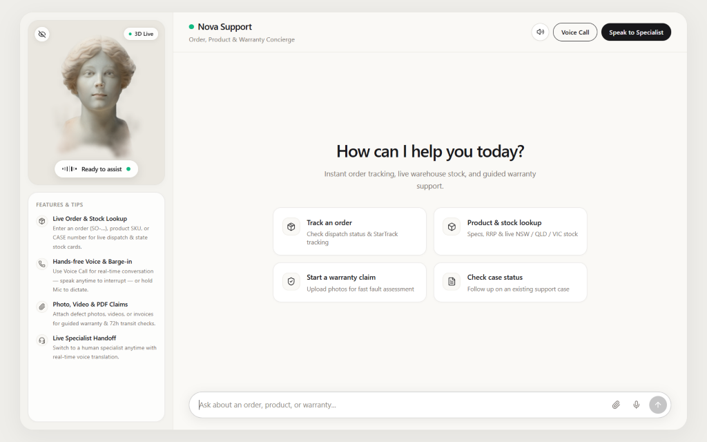
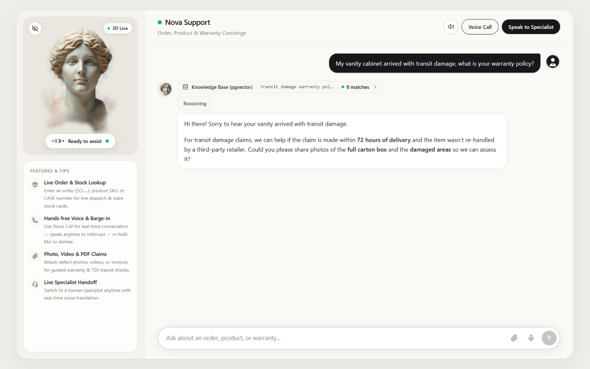
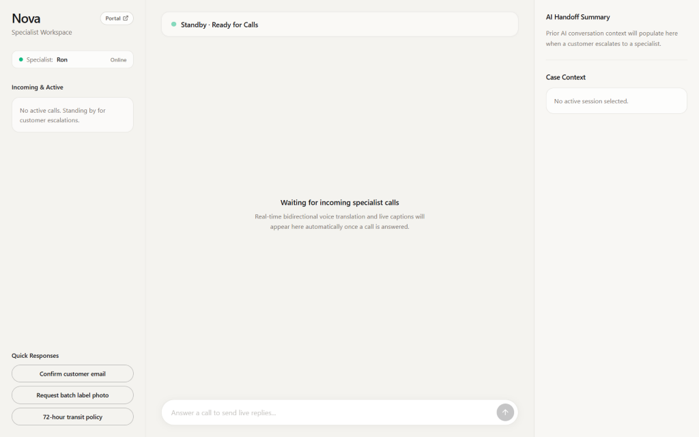
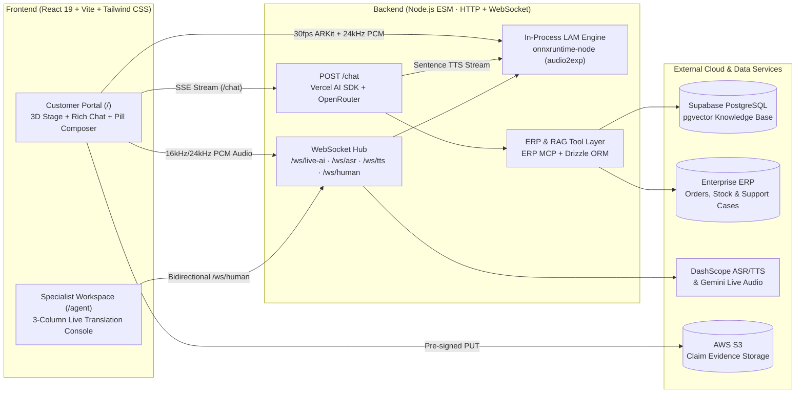

# Nova — AI 3D 数字人智能客服平台

[English](./README.md) | **简体中文**

一套面向品牌售后与跨境电商场景的**全栈多模态 AI 数字人智能客服平台**。系统集成了**浏览器端 WebGL 3D 高斯泼溅数字人（进程内 ONNX `audio2exp` 实时驱动）**、**流式大模型多步推理**、**Supabase `pgvector` 语义知识库检索（RAG）**、**实时 ERP 订单/库存/工单闭环集成**、**免按键全双工实时语音通话（支持随时打断）**，以及**三栏跨语言实时语音同传人工坐席工作台（`/agent`）**。

---

## 界面实拍展示

### 1. 客户端首屏：3D 数字人舞台、功能指引与快捷入口 (`/`)
左侧栏集成了 30fps 实时 WebGL 3D 高斯泼溅数字人舞台（支持滚轮缩放、一键隐藏/展开及实时声波状态反馈）与常驻 **Features & Tips** 功能指引；右侧提供极简对话工作区与高频售后快捷指令卡片。



### 2. 智能对话流：定制头像框、数据库工具追踪胶囊与思考过程
每当 Nova 检索 **Supabase `pgvector` 知识库** 或查询 **ERP 系统** 时，回复气泡正上方都会展示并永久保留可展开的查询追踪胶囊（点击可查看查询参数与命中详情）；查到有效订单、各州库存或工单时，自动渲染极简结构化业务卡片。



### 3. 三栏人工坐席工作台：跨语言实时语音同传 (`/agent`)
客户随时可点击 **Speak to Specialist** 呼叫人工专员。`/agent` 工作台为坐席提供来电队列管理、一键快捷话术、**英文客户 ⇄ 中文坐席** 双向实时语音同传与双语字幕、**AI 交接摘要（AI Handoff Summary）**，以及自动从前序对话提取的 **工单上下文（Case Context：订单号、SKU、工单号）**。



---

## 核心功能

### 1. 进程内 ONNX 3D 数字人 (`LAM 3D Gaussian Splatting`)
- **零 Python 依赖本地推理**：Node.js 后端通过 `onnxruntime-node` 在进程内直接加载 `lam_audio2exp.onnx`，结合内置 `ffmpeg` 音频解码，实时生成 **30fps、52 维 ARKit 面部表情权重**。
- **硬件时钟口型同步与毫秒级打断**：通过 WebSocket（`/ws/lam-client/:sessionId`）将同步的表情帧与 24kHz PCM 音频推送至浏览器端 `gaussian-splat-renderer-for-lam` 渲染，待机零服务端算力消耗，支持随时打断（Barge-in）。
- **自定义数字人角色资产**：可随时替换任意符合 LAM 规范的 `.zip` 角色包（详见 [LAM_CUSTOM_AVATAR_GUIDE.md](./LAM_CUSTOM_AVATAR_GUIDE.md)）。前端在 WebGL 首帧加载完成后会自动截取角色正脸作为聊天头像缩略图。

### 2. Supabase `pgvector` 语义知识库 (`RAG`)
- 基于 **PostgreSQL + `pgvector` + Drizzle ORM** 索引售后保修政策、瑕疵理赔判定标准、72 小时运输破损规则与常见故障排查 SOP。
- `getInformation` 工具支持多路并行语义召回并按余弦相似度去重，在需要核验产品批号时自动附带镜子、镜柜、浴室柜抽屉及外箱标签的位置指引图。

### 3. 实时 ERP 业务集成与结构化卡片
由内置的 **ERP MCP 工具层** 驱动（支持读写分离令牌鉴权），工具返回结果在聊天流中自动渲染为结构化业务卡片：

| 工具名称 | 核心能力 | 前端展示形态 |
| :--- | :--- | :--- |
| `getInformation` | 在 Supabase `pgvector` 中语义检索售后保修与故障排查 SOP | 可展开数据库追踪胶囊（显示命中条数与召回片段） |
| `check_order_status` | 实时查询 ERP 销售订单状态、发货批次、承运商与快递追踪号 | 可展开追踪胶囊 + **订单与物流追踪卡片**（支持一键复制运单号） |
| `get_product_info` | 实时查询 ERP 产品 SKU 规格、包装尺寸、建议零售价（RRP）及 `NSW / QLD / VIC` 三州库存 | 可展开追踪胶囊 + **产品与各州仓库实时库存卡片** |
| `start_warranty_claim` | 在 ERP 中正式创建 `Support Case` 售后工单，内置严格的**客户手输邮箱真实性校验**（防止误提发票图片上的门店邮箱） | 可展开追踪胶囊 + **售后工单确认卡片** |
| `check_case_status` | 凭工单编号与登记邮箱核验 ERP 中已有售后工单的最新进度与待补资料 | 可展开追踪胶囊 + **售后工单进度卡片** |

### 4. 全双工语音与多模态凭证流水线
- **免按键实时语音通话（`Voice Call` / `/ws/live-ai`）**：基于 Gemini Live 的低延迟端到端语音对话，自动继承前序文字上下文，通话中可实时调用 ERP/RAG 工具、支持随时开口打断并联动 3D 数字人口型。
- **按住说话实时转写（`/ws/asr`）**：基于阿里云百炼 DashScope Qwen（`qwen-audio-3.1-asr-flash-streaming`）的 16kHz PCM 流式语音转文字，配合实时悬浮字幕条。
- **流式语音播报与无感降级（`/ws/tts`）**：流式切句合成语音；连接 3D 数字人时由数字人播报，暂停 3D 模式时自动降级为浏览器 `MediaSource` 流式音频播放。
- **S3 凭证直传（`/upload-url`）**：支持照片前端压缩预览（直接送入多模态视觉理解）、故障视频与 PDF 购买发票通过预签名 S3 PUT 链接直传（本地开发支持 Mock 兜底）。

### 5. 跨语言人工客服转接 (`/agent`)
- **1 对 1 双向实时语音翻译（`/ws/human`）**：从 AI 对话无缝升级至真人专员，提供双向实时语音同传与双语对照字幕。
- **上下文无缝继承**：自动将转接前最近 AI 对话汇总至坐席右侧的 **AI Handoff Summary**，并自动提取对话中涉及的 `SO-…` 订单号、`SKU-…` 产品编码与 `CASE…` 工单号展示在 **Case Context** 中。

---

## 系统架构



---

## 目录结构

```text
AIChatBot-LAM-ONNX/
├── Frontend/                        # React 19 + Vite + Tailwind CSS 前端单页应用
│   ├── public/                      # 静态资源、批号位置指引图 (/guidance) 与 3D 头像默认缩略图
│   └── src/
│       ├── App.jsx                  # 客户端客服主页 (/)
│       ├── pages/AgentConsole.jsx   # 三栏人工坐席工作台 (/agent)
│       ├── components/
│       │   ├── AvatarPanel.jsx      # 左侧 3D WebGL 舞台与 Features & Tips 功能指引栏
│       │   ├── ToolResultCard.jsx   # 可展开数据库/ERP 追踪胶囊与订单/库存/工单结构化卡片
│       │   └── VoiceInputButton.jsx # 按住说话流式语音识别按钮与实时字幕浮层
│       └── hooks/                   # LAM WebGL、实时通话、人工转接、ASR 与 TTS Hooks
├── Backend/                         # Node.js (ESM) 服务端（支持本地常驻与 AWS SAM Lambda）
│   ├── assets/lam/                  # ONNX 模型 (lam_audio2exp.onnx) 与 3D 角色资产包 (.zip)
│   ├── setup/                       # 模型下载脚本、pgvector 知识库导入 (seed.js) 与 RAG 测试脚本
│   └── src/
│       ├── index.js                 # 统一 HTTP + 多路 WebSocket 服务入口
│       ├── ai/                      # OpenRouter 流式对话编排与售后 SOP 系统提示词
│       ├── avatar/                  # 进程内 ONNX 表情推理、音频解码与 /ws/lam-client 推送服务
│       ├── audio/                   # DashScope ASR/TTS、Gemini Live 语音通话与人工同传通道
│       ├── erp/                     # 进程内 ERP MCP 客户端与订单/产品/保修业务工具
│       └── rag/                     # Supabase PostgreSQL + pgvector 表结构、向量嵌入与召回
├── docs/images/                     # 实机运行界面展示截图
└── LAM_CUSTOM_AVATAR_GUIDE.md       # 自定义 LAM 3D 数字人生成与导出操作手册
```

---

## 快速启动

### 环境要求
- **Node.js** `>= 20.x`
- **PostgreSQL (Supabase)**：已启用 `vector`（`pgvector`）扩展

### 1. 后端配置与启动 (`Backend`)

```bash
cd Backend
cp .env.example .env
npm install
```

在 `Backend/.env` 中配置所需凭证（切勿提交 `.env` 或真实密钥）：
- `OPENROUTER_API_KEY` — 大模型对话与向量嵌入（Embedding）服务密钥
- `DATABASE_URL` — Supabase PostgreSQL 数据库连接串
- `DASHSCOPE_API_KEY` — 实时流式语音识别（ASR）与语音合成（TTS）
- `GEMINI_API_KEY` — 免按键 `Voice Call` 实时通话与 `/agent` 跨语言人工同传
- ERP 集成相关凭证（参考 `Backend/.env.example`）

（可选）若尚未下载 ONNX 表情模型权重或首次初始化售后知识库向量表：

```bash
npm run download:model
npm run db:seed
```

启动后端服务（默认监听 `http://localhost:8080`）：

```bash
npm run dev
```

### 2. 前端启动 (`Frontend`)

新建终端执行：

```bash
cd Frontend
npm install
npm run dev
```

浏览器打开：
- **客户端客服主页**：`http://localhost:5173`
- **人工坐席三栏工作台**：`http://localhost:5173/agent`

---

## HTTP 与 WebSocket 接口一览

| 协议 | 路径 | 说明 |
| :--- | :--- | :--- |
| `POST` | `/chat` (`/api/chat`) | Vercel AI SDK 流式对话、多步 ERP/RAG 工具调用与 TTS/数字人旁路触发 |
| `POST` | `/upload-url` | 生成照片、视频及 PDF 附件直传 S3 的预签名 PUT 地址 |
| `POST` | `/api/avatar/interrupt` | 主动打断当前 TTS 语音合成并清空 3D 数字人播报队列 |
| `GET` | `/lam/initconfig` · `/lam/asset/:file` | 返回 3D 角色 ARKit 表情通道配置与 `.zip` 高斯点云资产包 |
| `WS` | `/ws/lam-client/:sessionId` | 推送 30fps ARKit 表情帧与 24kHz PCM 同步语音流 |
| `WS` | `/ws/live-ai` | Gemini Live 免按键全双工实时语音对话通道 |
| `WS` | `/ws/asr` | DashScope 16kHz PCM 流式语音转文字通道 |
| `WS` | `/ws/tts` | 3D 数字人暂停时的 DashScope 流式语音播报兜底通道 |
| `WS` | `/ws/human` | 客户端与 `/agent` 坐席端 1 对 1 跨语言实时语音同传与文字通道 |

---

## 安全与云开发环境说明

- 严禁提交 `.env` 文件、代理订阅配置或任何真实 API 密钥，请以 `Backend/.env.example` 作为模板。
- 生产部署前，请将 `Backend/src/erp/` 中的自定义字段占位符（`custitem_custom_*`、`custevent_case_evidence_link`）替换为实际 ERP 账号字段。
- 后端部署详情见 [Backend/README.md](./Backend/README.md)，自定义 3D 数字人制作见 [LAM_CUSTOM_AVATAR_GUIDE.md](./LAM_CUSTOM_AVATAR_GUIDE.md)。

<details>
<summary><strong>云原生开发环境代理配置与 GitHub 自动同步说明 (CNB)</strong></summary>

### 1. 受地区限制的 Gemini Live 接口代理配置（可选）
Gemini Live 在 WebSocket 握手阶段会按出口 IP 校验地区（不支持时返回 `code=1007`）。后端仅在 `Backend/.env` 中显式配置 `HTTPS_PROXY`、`HTTP_PROXY` 或 `ALL_PROXY` 时启用代理：

```bash
mkdir -p /workspace/proxy && cd /workspace/proxy
curl -L --fail -o mihomo.gz \
  https://github.com/MetaCubeX/mihomo/releases/download/v1.19.34/mihomo-linux-amd64-compatible-v1.19.34.gz
gunzip -f mihomo.gz && chmod +x mihomo
# 将代理配置放到 /workspace/proxy/config.yaml（需包含 mixed-port: 7890，切勿提交到 Git）
./mihomo -d . -t
nohup ./mihomo -d . > mihomo.log 2>&1 &
```

随后在 `Backend/.env` 中开启 `HTTPS_PROXY=http://127.0.0.1:7890` 并重启 `npm run dev`（也可执行 `bash /workspace/Backend/setup/setup-proxy.sh` 从 `/root/.cnb/` 一键恢复漫游配置）。

### 2. 通过 `.cnb.yml` 自动同步至 GitHub
仓库内置 `.cnb.yml`（基于 `tencentcom/git-sync` 插件）。在个人 CNB 密钥仓库创建 `github-sync.yml` 填入 `GITHUB_REPO_URL`、`GIT_USERNAME` 与 `GIT_ACCESS_TOKEN`，并将 `.cnb.yml` 中的 `YOUR_SECRET_REPO_SLUG` 替换为对应密钥仓库路径后，每次向 `main` 分支推送即可自动同步至 GitHub。

</details>
